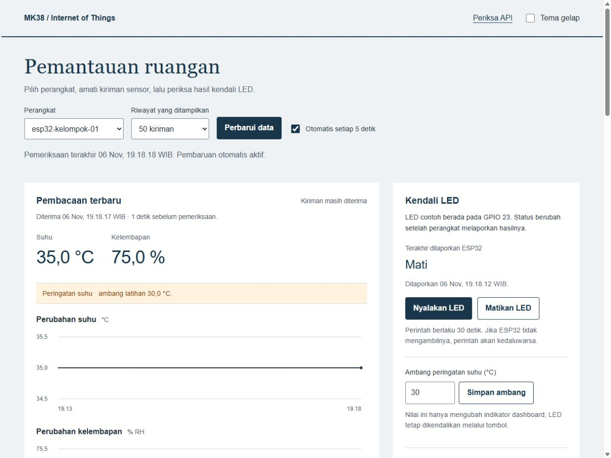
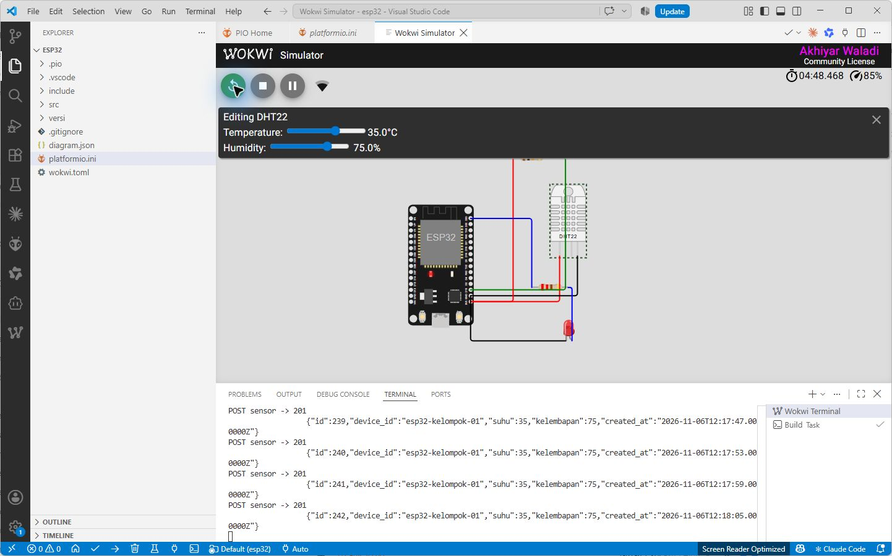

# Dari API sensor ke dashboard dan kendali balik

Lanjutkan setelah langkah 1 sampai 8 pada [panduan API](README.md) lulus dan bukti pada langkah 9 terkumpul. Berkas `.env` yang sudah diisi tetap dipakai. Laravel dan MySQL harus berjalan. Pada ESP32, kembali ke `versi/03_sensor.cpp` jika ingin mempelajari tampilan data sebelum kendali.

Siapkan browser untuk melihat hasil, terminal A yang tetap menjalankan Laravel, serta terminal B untuk client Python. Jalankan skrip Python dari akar lab, yaitu folder yang memuat `backend`, `client_python`, dan `esp32`. Gunakan Python 3.10 atau lebih baru dengan pustaka standar; tidak ada paket pip tambahan. Contoh memakai `python`; ganti dengan `python3` pada Linux/macOS atau `py -3` pada Windows bila itu perintah yang tersedia.

Baca konfigurasi dan seluruh fungsi `minta()` pada `client_python/http_json.py` mengikuti README sebelum memakai skrip lanjutan. Setiap langkah di bawah menambah satu bagian alur. Berkas lengkap sudah disertakan agar hasil dapat dibandingkan; baca cuplikan dan lakukan pemeriksaan tiap langkah sebelum berpindah ke berkas lengkap.

## 10. Tampilkan tabel dari MySQL dengan Blade

Buka `http://127.0.0.1:8000/latihan/tabel`. Halaman menampilkan sepuluh kiriman terakhir. Pilih **Baca ulang** setelah mengubah sensor. Data belum diperbarui otomatis pada halaman ini.

Di `backend/routes/web.php`, satu route menghubungkan query dengan view:

```php
Route::get('/latihan/tabel', fn () => view('table', [
    'rows' => Sensor::latest('id')->limit(10)->get(),
]));
```

`latest` mengurutkan ID terbesar lebih dahulu; `limit` membatasi hasil; `get` membaca data. Pada `resources/views/table.blade.php`, perulangan mengubah setiap objek menjadi baris HTML:

```blade
@forelse ($rows as $row)
    <tr><td>{{ $row->id }}</td><td>{{ $row->device_id }}</td></tr>
@empty
    <tr><td colspan="2">Belum ada kiriman.</td></tr>
@endforelse
```

Cuplikan ini hanya menunjukkan dua kolom; berkas lengkap juga menampilkan suhu dan kelembapan. `{{ ... }}` meng-escape teks. Sebelum lanjut, cocokkan satu ID di tabel dengan `GET /api/v1/sensor/{id}` dan MySQL.

## 11. Ambil JSON untuk mengisi tampilan

Dari folder `backend`, jalankan migration dan aktifkan route dashboard. Blok penyalinan berikut memakai PowerShell Windows:

```powershell
php artisan migrate
Copy-Item ../tahapan/04_api_dashboard.php routes/api.php
php artisan route:list --path=api
cd ..
```

Terminal B kini kembali ke akar lab agar perintah Python berikut dapat dijalankan. Pada Linux/macOS, salin `tahapan/04_api_dashboard.php` melalui Explorer VS Code untuk menggantikan `backend/routes/api.php`, lalu jalankan perintah PHP dari `backend` dan kembali ke akar lab. Perintah `Copy-Item` khusus PowerShell Windows.

Migration baru membuat `devices` dan `commands`; kiriman sensor lama tetap tersedia. Perangkat yang pernah mengirim sensor didaftarkan saat migration. Kiriman perangkat baru mendaftarkan `device_id` secara otomatis. Penyalinan route diperlukan jika sebelumnya memakai `03_api_mysql.php`, yang hanya memuat empat endpoint pengantar.

Buka `http://127.0.0.1:8000/api/v1/pemantauan?device_id=esp32-kelompok-01&limit=20` pada browser; sesuaikan ID dengan firmware. Baca `latest`, `readings`, `age_seconds`, dan `online`. `online` berarti ada kiriman sensor dalam 30 detik terakhir, bukan hasil pemeriksaan ping atau jaminan seluruh fungsi perangkat normal. Jika koneksi gagal, periksa terminal A; jika 404, periksa penyalinan route dashboard. Pulihkan sampai respons JSON dapat dibaca sebelum melanjutkan.

Buka `http://127.0.0.1:8000/dashboard`. Pilih perangkat dan jumlah kiriman. Untuk mengamati alurnya, matikan pembaruan otomatis lalu pilih **Perbarui data** sendiri.

Sebelum dashboard penuh, buka `http://127.0.0.1:8000/latihan/nilai`. Isi ID perangkat dan pilih **Baca satu catatan**. Baca `resources/views/latest.blade.php`: formulir memicu satu `fetch`, API mengembalikan larik paling banyak satu catatan, lalu `textContent` mengisi ID dan nilai. Coba juga ID yang belum mengirim data. Tahap ini sengaja belum menggambar grafik atau mengirim perintah aktuator.

Baca `public/dashboard.js` secara berurutan: `api()` menerima JSON; `refresh()` meminta data; `render()` mengisi teks dan tabel. Mulai dari isi respons: `latest.suhu` adalah angka terbaru, sedangkan `readings` berisi beberapa catatan untuk grafik. Permintaan GET tidak menulis baris sensor baru.

Inti pembacaan HTTP pada `api()` adalah:

```javascript
const response = await fetch(path, {
    cache: 'no-store',
    signal: AbortSignal.timeout(8000),
    headers: {Accept: 'application/json'}
});
const body = await response.json();
if (!response.ok) throw new Error(body.message || `HTTP ${response.status}`);
return body;
```

Ini cuplikan untuk membaca fungsi, bukan pengganti seluruh `dashboard.js`. `await` menunggu respons; `response.json()` membaca body; pemeriksaan `ok` mencegah respons gagal dianggap berhasil. Waktu tunggu dibatasi delapan detik. Sesudah itu, lihat dua penugasan teks pada `render()`: nilai dimasukkan dengan `textContent`, bukan disisipkan sebagai HTML dari input perangkat. Terakhir, baca `refresh()` yang memanggil kedua fungsi dan menampilkan pesan gagal.

Sebelum lanjut: jumlah kiriman yang tampil mengikuti pilihan, ID tabel sesuai API, dan perangkat tanpa kiriman menampilkan pesan kosong. Data lama tidak diberi label sebagai kiriman yang masih aktif.

## 12. Gambar perubahan nilai, lalu ekspor buktinya

Fungsi `chart()` membuat titik dari `created_at` dan nilai sensor. Sumbu X dihitung dari selisih waktu, bukan sekadar nomor urut. Suhu dan kelembapan dibuat pada dua grafik karena satuannya berbeda. Bila hanya ada satu kiriman, grafik menampilkan satu titik.

Ubah masukan DHT22, pilih **Perbarui data**, lalu periksa garis dan baris terbaru. Pilih **Unduh CSV**. `DashboardController::csv()` mengambil data perangkat dan batas jumlah yang sama. Tautan juga membawa `until_id`, yaitu ID terbaru yang sedang ditampilkan, sehingga kiriman baru selama pengunduhan tidak menggeser isi CSV. Tabel menaruh ID terbaru di atas; grafik dan CSV mengurutkan catatan dari lama ke baru. Kolom `diterima_utc` memakai UTC, sedangkan tampilan memakai WIB.



Tangkapan layar pengujian menampilkan 35 °C dan 75%, bukan data bawaan dashboard. Grafik dapat mendatar bila seluruh catatan yang dipilih memiliki nilai sama. Ubah DHT22 dan tunggu kiriman baru untuk melihat perubahan.

Ubah **Ambang peringatan suhu** dan pilih **Simpan ambang**. Metode `DeviceController::settings()` memvalidasi serta menyimpan nilai. Indikator membandingkan suhu terakhir dengan ambang tersimpan; belum ada kendali otomatis pada LED.

Sebelum lanjut: satu nilai dari grafik dapat ditelusuri ke baris CSV dan ID MySQL. Ambang yang diubah tetap ada setelah halaman dibuka ulang. Coba nilai di atas 80: formulir/API harus menolak, bukan menyimpannya.

## 13. Simpan perintah sebelum mengubah perangkat

Tiga endpoint membentuk alur kendali:

| Endpoint | Makna |
|---|---|
| `POST /api/v1/perangkat/{device_id}/perintah` dengan `{"led":true}` | API membuat perintah dan membalas 202. LED belum dinyatakan berubah. |
| `GET /api/v1/perangkat/{device_id}/perintah` | ESP32 mengambil perintah terbaru yang masih menunggu dan belum kedaluwarsa. |
| `POST /api/v1/perangkat/{device_id}/konfirmasi` dengan `command_id` serta `led` | ESP32 melaporkan hasil GPIO; API memeriksa ID dan nilai sebelum mengubah status menjadi `applied`. |

Tabel `commands` menyimpan waktu dibuat, waktu berlaku, dan waktu konfirmasi. Perintah baru mengganti perintah lama yang masih menunggu. Setelah 30 detik, perintah tanpa konfirmasi tidak boleh diterapkan melalui endpoint konfirmasi. Status `expired` dihitung saat API membaca `expires_at`; kolom status mentah di MySQL dapat masih bernilai `pending`. Pengulangan konfirmasi untuk perintah yang sudah berhasil tidak mengubah laporan LED yang lebih baru.

Untuk melihat perbedaannya, jalankan firmware `versi/03_sensor.cpp` yang belum mengambil perintah, lalu pilih **Nyalakan LED**. Dashboard harus menunjukkan menunggu, kemudian kedaluwarsa; LED tidak boleh diklaim nyala. Sesudah uji ini, lanjutkan tahap berikut.

Untuk menelusuri permintaan tanpa tombol, buka `client_python/05_perintah_led.py`. Skrip ini memakai `minta()` yang sudah dibaca pada README. Pastikan `ID_SENSOR` pada `client_python/konfigurasi.py` sama dengan `DEVICE_ID` firmware dan sudah memiliki kiriman sensor. Pertahankan `NILAI_LED = True` untuk permintaan nyala. Jalankan di terminal B dari akar lab:

```sh
python client_python/05_perintah_led.py
```

Hasil normal menampilkan POST HTTP 202 beserta `id`, `status`, dan `expires_at`, lalu GET HTTP 200 yang membungkus perintah pada field `command`. Pada firmware `03_sensor.cpp`, status masih pending dan GPIO belum diubah oleh permintaan ini. Ubah `NILAI_LED` menjadi `False` hanya saat ingin membuat permintaan mati baru; Python mengubah `True`/`False` menjadi boolean JSON. Setiap menjalankan skrip membuat ID perintah baru, sehingga jangan memakainya hanya untuk menyegarkan tampilan. Gunakan **Perbarui data** pada dashboard untuk membaca status perintah yang sama sesudah 30 detik.

Jika muncul `Perintah ditolak`, baca HTTP dan JSON sebelumnya: 404 dapat berarti ID belum terdaftar melalui kiriman sensor atau route dashboard belum aktif; pulihkan keduanya sebelum mengulang. Jika koneksi gagal, jalankan `client_python/01_health.py` dari akar lab setelah memeriksa server. Kembalikan `NILAI_LED = True` setelah percobaan mati bila ingin mengulang contoh awal. Jangan mengirim konfirmasi sendiri lalu menyebutnya bukti ESP32: konfirmasi pada langkah berikut berasal dari firmware.

## 14. Tambahkan pengambilan dan konfirmasi pada ESP32

Hentikan simulator. Buka terminal PlatformIO pada folder `esp32`. Blok penyalinan berikut memakai PowerShell Windows; pada Linux/macOS, salin `versi/04_kendali.cpp` melalui Explorer VS Code untuk menggantikan `src/main.cpp`, lalu jalankan Build:

```powershell
Copy-Item versi/04_kendali.cpp src/main.cpp
pio run
```

`platformio.ini` menambahkan ArduinoJson 7.4.2 untuk membaca respons. Urutan tambahan pada firmware:

1. `pinMode` dan `digitalWrite(LED_PIN, LOW)` menetapkan keadaan awal LED GPIO 23.
2. `requestApi()` merangkum bagian HTTP yang sebelumnya berulang; body kosong dipakai untuk GET, body JSON untuk POST.
3. `periksaPerintah()` membaca `command`, memeriksa tipe ID/status, dan menerapkan GPIO jika perintah ada.
4. Sesudah `digitalWrite`, program membaca nilai GPIO dan mengirim `command_id` yang sama ke endpoint konfirmasi.
5. `laporLed()` melaporkan keadaan saat boot dan secara berkala. Setelah ESP32 dimulai ulang, keadaan awal mati dilaporkan lagi; dashboard tidak hanya mengingat perintah nyala sebelumnya.
6. `millis()` menjadwalkan pemeriksaan perintah sekitar satu detik dan telemetri sekitar lima detik. Panggilan HTTP masih dapat menunggu sampai timeout; ini belum sistem dengan batas waktu kendali yang dijamin.

Sebelum membaca seluruh fungsi `periksaPerintah()`, cocokkan bagian kecil berikut dengan respons GET pada langkah 13:

```cpp
JsonDocument document;
if (deserializeJson(document, reply) || document["command"].isNull()) return;
JsonObject command = document["command"].as<JsonObject>();
```

`reply` berasal dari `requestApi()`. Parsing gagal atau `command: null` membuat fungsi selesai tanpa menyentuh LED. Sesudah pemeriksaan tipe pada berkas lengkap, dua baris berikut menerapkan permintaan dan membaca hasil GPIO:

```cpp
digitalWrite(LED_PIN, command["led"].as<bool>() ? HIGH : LOW);
bool applied = digitalRead(LED_PIN) == HIGH;
```

Baru setelah itu body konfirmasi dibuat dari `command["id"]` dan `applied`. Urutan ini menjelaskan mengapa status `pending` tidak sama dengan `applied`. Kedua cuplikan adalah bagian fungsi yang sudah disertakan; jangan menempelkannya lagi di luar fungsi.

Mulai Wokwi. Pilih **Nyalakan LED**, tunggu keterangan “Dikonfirmasi ESP32”, lalu periksa LED dan Serial. Ulangi dengan **Matikan LED**. Baris Serial menyebut ID perintah serta status konfirmasi 200. `GET /api/v1/perangkat/{device_id}/status` tidak disediakan; laporan status memakai **POST**, sedangkan pembacaannya ada pada `device` dalam respons pemantauan.

Sebelum lanjut: dua perintah mempunyai ID berbeda dan waktu konfirmasi; perubahan tampak pada LED serta laporan GPIO. Setelah uji, kembalikan LED ke keadaan mati.



Jika Serial mengulang status HTTP negatif, periksa proses API terlebih dahulu. Saat pengujian lama, jalankan server di terminal yang tetap dibaca atau arahkan log ke berkas. Pada pengujian pengajar, penumpukan keluaran proses server sempat membuat request menunggu; setelah pencatatan log diperbaiki, pengujian firmware diulang hingga nyala dan mati terkonfirmasi.

## 15. Periksa hasil sebelum mengembangkan proyek

Jangan menambah sensor baru sebelum kelima pemeriksaan ini lulus:

| Pemeriksaan | Hasil yang harus terlihat |
|---|---|
| Ubah DHT22 | ID baru dapat dibaca kembali melalui GET dan SELECT MySQL. |
| Pilih jumlah riwayat dan unduh CSV | ID pada CSV sama dengan tabel yang dipilih; urutannya berlawanan. |
| Kirim nyala, lalu mati | Dua ID perintah berbeda berstatus dikonfirmasi, sesuai LED di simulator. |
| Hentikan simulator | Setelah 30 detik, dashboard menyatakan belum ada kiriman baru. Data terakhir tetap terlihat dengan waktunya. |
| Hentikan API, lalu jalankan kembali | Pesan koneksi gagal muncul; setelah pulih, catatan lama tetap tersedia. |

Lihat [hasil uji edisi dashboard](VERIFIKASI_DASHBOARD.md) untuk bukti yang sudah dilakukan pengajar serta batas pengujiannya.

## 16. Hubungkan ke topik kelompok

Baca [pemetaan brief proyek](PENGEMBANGAN_PROYEK.md). Tentukan field, aktuator, dan metrik yang perlu ditambah. Pertahankan pembeda antara data terakhir, perintah yang diminta, serta hasil yang dilaporkan perangkat. Gunakan MQTT bila diwajibkan topik; lab REST ini masih berjalan lokal tanpa autentikasi perangkat atau HTTPS.
